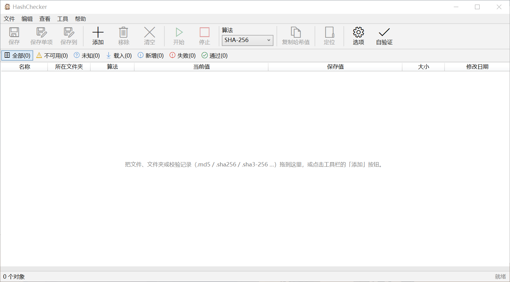

# HashChecker

<div align="center">



[English](#english) | [中文](#中文)

</div>

---

## English

### What it is

A Windows GUI checksum verifier. One window, seventeen hash algorithms, and it
reads the checksum records other tools leave behind.

Drag files or `.sha256` / `.md5` / `.sha3-512` records into the window, or pass
them on the command line. The list fills up, the values get computed, and every
row is judged against the saved value it found.

- Seventeen algorithms: MD5, SHA-1, the whole SHA-2 family, the whole SHA3
  family, BLAKE2, CRC-32 and CRC-64.
- Reads records written by other tools: `hash *file`, `hash  file`,
  `name = hash`, `SHA256 (name) = hash`, quoted names, relative sub-folders.
- Tolerant about encoding: UTF-8, UTF-8 with BOM, UTF-16 (with or without BOM),
  UTF-32, GB18030, GBK, Big5, Shift_JIS, EUC-KR.
- Two-way lookup: drop a record and it finds the file it describes; drop a file
  and it looks for a record that mentions it.
- Three languages: English, 简体中文, 繁體中文.

### How to start it

There is one executable. Which entry you use decides what it does with the
paths it is given.

| How you start it | Main window | What it does |
|---|---|---|
| Double-click `HashChecker.exe` | yes | Opens the empty list |
| `HashChecker.exe file...` | yes | Opens the list already filled, then hashes |
| Drag files onto `HashChecker.exe` | yes | Same as above |
| Drag files into a running window | already open | Adds to the existing list |

#### What a dropped record does

A record — a file whose name ends in an algorithm suffix such as `.sha256`, or
whose whole content is checksum lines — is treated as an instruction to verify,
not as a file to be hashed:

- drop `payload.bin.sha256` and the list gets `payload.bin`, with the saved
  value filled in, and hashing starts by itself;
- drop `payload.bin` and the program looks next to it for a
  `payload.bin.<algorithm>` record, or any record that mentions that file;
- no record anywhere means it just computes the value and does not judge.

Hashing starts automatically after a record is loaded, because dropping a
record is an unambiguous request to verify. Plain files only start
automatically if **Start hashing automatically after adding files** is enabled;
it is off by default.

### Requirements

- Windows only, x64.
- .NET Framework 4.7.2, WPF.
- Visual Studio 2022 (or newer) with the .NET desktop workload, to build the
  C# project.
- No NuGet packages. Nothing is downloaded at build or run time.

### Layout

```
HashChecker_WPF/
├── HashChecker.sln
├── HashChecker/                     the WPF application
│   ├── HashChecker.csproj           → HashChecker.exe
│   ├── App.xaml.cs                  startup, command-line dispatch
│   ├── MainWindow.xaml              main window (list, toolbar, filter bar)
│   ├── MainWindow.xaml.cs           adding, hashing, saving, comparing
│   ├── ListRubberBand.cs            drag-a-rectangle multi-select
│   ├── CalculatorWindow.xaml        Tools → digest calculator
│   ├── CompareWindow.xaml           paste a value and compare
│   ├── OptionsWindow.xaml           settings
│   ├── AboutWindow.xaml
│   ├── Localization.cs              three language dictionaries
│   ├── Models/
│   │   ├── CheckItem.cs             one row: status, values, algorithm
│   │   └── HashValues.cs            value formatting and comparison
│   └── Services/
│       ├── HashAlgorithms.cs        the catalogue: ids, suffixes, aliases
│       ├── HashCores.cs             MD5/SHA-1/SHA-2/SHA-224 kernels
│       ├── HashCores2.cs            SHA3 (Keccak), CRC-32, CRC-64
│       ├── HashCores3.cs            BLAKE2s, BLAKE2b
│       ├── HashingEngine.cs         parallel hashing, progress
│       ├── ChecksumFile.cs          record parsing and writing
│       ├── ChecksumResolver.cs      record ↔ file lookup
│       ├── TextEncoding.cs          tolerant decoding
│       ├── JsonText.cs              minimal JSON parser
│       ├── AppSettings.cs           settings.json read and write
│       └── AppSettingsHost.cs       process-wide settings
└── testtools/                       see testtools/README.md
```

### Building

```powershell
msbuild HashChecker.sln /t:Rebuild /p:Configuration=Release
```

Or open `HashChecker.sln` in Visual Studio and build. The output lands in
`HashChecker\bin\<Configuration>\HashChecker.exe`.

There is nothing to install and nothing to register. The exe is self-contained;
copying it to another machine is enough.

### Usage

Add files with **Add** (`Insert`), by dragging, or on the command line. Files
that already have a saved value are judged as soon as they are hashed.

| Column | Meaning |
|---|---|
| Name | file name, folders end with `\` |
| Folder | containing folder |
| Algorithm | which algorithm this row is actually using |
| Current value | what was computed here |
| Saved value | what the record says it should be |
| Size, Modified | read from disk |

The **Algorithm** column is the honest answer to "what is this row doing": it
shows the algorithm that was actually used. When a record pins the algorithm it
shows that one; when a value length matches several algorithms (SHA-256 and
SHA3-256 are both 64 hex characters) it lists the candidates instead of
pretending to know.

The algorithm picker in the toolbar applies to rows that have no record. Every
new row follows whatever is selected there, so switching to SHA3-512 and then
dropping a file hashes with SHA3-512. Rows that already have a saved value keep
the algorithm their record dictates until you pick another one explicitly —
picking overrides the record, and the row is recomputed.

Filter buttons across the top narrow the list: All, Unavailable, Unknown,
Loaded, New, Failed, Passed.

Drag a rectangle in the list's content area to select several rows at once; hold
`Ctrl` to add to the existing selection. The scrollbar strip is deliberately left
out of the selection region, so the scrollbar keeps working normally during and
after a drag. Double-clicking a row that has a value
opens the compare dialog; a row without a value is located in Explorer instead.
`Enter` hashes; `Esc` stops.

Column widths auto-fit the list width: they are assigned on startup, whenever the
window is resized, and again after maximize/restore. The four text columns share
the leftover space proportionally while Size, Modified and Algorithm stay fixed,
so the two hash columns never get squeezed out and no horizontal scrollbar
appears for that reason alone. If you drag a column border by hand and want the
computed widths back, use **Auto-fit Column Widths** in the list's context menu.

#### Saving records

**Save** (`Ctrl+S`) writes every row that has a value. **Save item**
(`Ctrl+Shift+S`) writes only the selected rows, next to the file, named
`<file>.<algorithm>`.

The suffix always matches the algorithm that produced the value: hashing with
SHA3-512 writes `.sha3-512`, never `.sha256`. That matters because the suffix is
what the program reads back when the file returns — a wrong suffix means a
wrong algorithm and a "failed" verdict that is nobody's fault but the file name.

Written as `hash *name`, one per line. UTF-8 without a BOM by default, because
many tools (sha256sum, 7-Zip, online checkers) choke on a leading U+FEFF and
report the whole line as unparsable. The BOM can be turned back on in Options
for tools that want it.

#### Where the settings live

`%LOCALAPPDATA%\HashChecker\settings.json`. Local rather than roaming, because
the file records window coordinates, and a roaming profile would put the window
off-screen on a machine with a different monitor layout.

| Setting | Default | Meaning |
|---|---|---|
| Threads | CPU cores, capped at 8 | parallel files |
| Upper case | off | display and write values in upper case |
| Auto start after add | **off** | start hashing as soon as plain files are added |
| Auto load companion | on | look for records next to files being added |
| UTF-8 BOM | **off** | write a BOM into records |
| Default algorithm | SHA-256 | used when no record pins one |
| Remember window | on | restore position and size |

### Records it can read

A record is any file whose lines are `hexdigest [separator] filename`. The
algorithm comes from the suffix if the name has one, and from the value length
otherwise.

| Suffix | Algorithm | Suffix | Algorithm |
|---|---|---|---|
| `.md5` | MD5 | `.sha512-224` | SHA-512/224 |
| `.sha1` | SHA-1 | `.sha512-256` | SHA-512/256 |
| `.sha224` | SHA-224 | `.sha3-224` | SHA3-224 |
| `.sha256` | SHA-256 | `.sha3-256` | SHA3-256 |
| `.sha384` | SHA-384 | `.sha3-384` | SHA3-384 |
| `.sha512` | SHA-512 | `.sha3-512` | SHA3-512 |
| `.blake2s` | BLAKE2s-256 | `.blake2b-256` | BLAKE2b-256 |
| `.blake2b` | BLAKE2b-512 | `.crc32` | CRC-32 |
| `.crc64` | CRC-64 | | |

Other spellings are accepted too: `.sha256sum`, `.sha2`, `.b2s`, `.crc`,
`.sfv`. A container suffix is peeled once first, so `hash.md5.txt` still reads
as MD5. A bare `.sha3` means SHA3-256, since without a bit count there is
nothing else it could mean.

A record does not have to spell the filename the way the disk does. If the record
says `report` and the disk has `report.txt`, that is a match, and so is the other
direction. Different extensions never match: `.zip` will not be taken for `.exe`,
because that would hash the wrong file.

When the suffix contradicts the value length — a 32-character MD5 value inside
a file named `.sha256` — the value length wins. A length is hard evidence; a
suffix is a name someone typed.

### Exit codes

The program is a GUI application (`WinExe`), so it has no console exit-code
contract. From the command line it opens the window like a double-click would.

### Progress and cancelling

Progress is bytes processed over bytes total. Hashing runs on a background
thread pool, one file per worker; `Esc`, or **Stop**, cancels the current run
and leaves completed rows as they are.

The progress callback is throttled to roughly sixteen updates a second, and the
clock read behind that throttle is `Environment.TickCount`, not
`DateTime.UtcNow` — at one megabyte per read the throttle is on the hot path.

### How it works

Files are read sequentially in 1 MB chunks and fed to an incremental kernel
(`IHashCore`: `Initialize` / `Append` / `Finish`). One read serves every
algorithm the row needs, so a row that has to try several candidates still
reads the file once.

The kernels are:

| Source | Algorithms |
|---|---|
| .NET Framework (`BuiltInCore` adapter) | MD5, SHA-1, SHA-256, SHA-384, SHA-512 |
| Written here, SHA-2 64-bit word | SHA-512/224, SHA-512/256 |
| Written here, SHA-2 32-bit word | SHA-224 |
| Written here, Keccak-f[1600] sponge | SHA3-224, SHA3-256, SHA3-384, SHA3-512 |
| Written here | BLAKE2s-256, BLAKE2b-256 |
| Written here, table driven | CRC-32/ISO-HDLC, CRC-64/XZ |

Framework algorithms are not reimplemented: the ones that ship with .NET are
already validated, and rewriting them buys nothing but risk. The rest are
written here because .NET Framework 4.7.2 has no SHA-3, no BLAKE2, and its
`HashAlgorithm.Create` does not know those names at all.

Every kernel must be correct on empty input, on one byte, on exactly one block,
on one block plus one byte, and it must stream — memory use does not grow with
file size. The test probes in `testtools/` check exactly that.

Records are decoded tolerantly because they come from everywhere. The order
matters: BOM first, then UTF-16 without a BOM (judged by where the NUL bytes
sit), then strict UTF-8, then the legacy code pages. UTF-16 has to come before
UTF-8: its byte stream decodes "successfully" as UTF-8 into text full of NULs,
and the entire record then parses as empty.

### External dependencies

None. No NuGet packages, no bundled binaries, no runtime downloads.

The JSON reader for the settings file is about four hundred lines written here
rather than pulled from a package: .NET Framework 4.7.2 has no built-in JSON
serializer, `System.Text.Json` is .NET Core only, and `System.Web.Extensions`
would drag a large assembly into a portable tool for the sake of ten flat keys.

## 中文

### 这是什么

一个 Windows 图形界面的哈希校验工具。一个窗口，十七种算法，并且能读别的工具留下的校验记录。

把文件或 `.sha256` / `.md5` / `.sha3-512` 之类的校验记录拖进窗口，或者用命令行传进来。列表填好，值算出来，每一行都会跟它找到的保存值比对。

- 十七种算法：MD5、SHA-1、SHA-2 全系、SHA3 全系、BLAKE2、CRC-32 与 CRC-64。
- 能读别的工具写的记录：`hash *file`、`hash  file`、`name = hash`、`SHA256 (name) = hash`、带引号的文件名、相对子目录。
- 编码宽容：UTF-8、带 BOM 的 UTF-8、UTF-16（有无 BOM）、UTF-32、GB18030、GBK、Big5、Shift_JIS、EUC-KR。
- 双向查找：拖进记录，它去找记录里写的文件；拖进文件，它去找提到这个文件的记录。
- 三种语言：English、简体中文、繁體中文。

### 启动方式

只有一个可执行体。用哪种入口启动，决定它拿到的路径怎么处理。

| 启动方式 | 主窗口 | 做什么 |
|---|---|---|
| 双击 `HashChecker.exe` | 有 | 打开一个空列表 |
| 命令行 `HashChecker.exe 文件...` | 有 | 列表已填好，随后开始计算 |
| 把文件拖到 `HashChecker.exe` 图标上 | 有 | 同上 |
| 把文件拖进已打开的窗口 | 本来就是开着的 | 追加到现有列表 |

#### 拖入校验记录会发生什么

校验记录 —— 文件名以算法后缀结尾（如 `.sha256`）的文件，或者整个内容都是校验行的文件 —— 会被当成「要校验」的指令，而不是一个待计算的普通文件：

- 拖入 `payload.bin.sha256`，列表里出现 `payload.bin`，保存值已经填好，并且自动开始计算；
- 拖入 `payload.bin`，程序会在它旁边找 `payload.bin.<算法>` 的记录，或者任何提到这个文件的记录；
- 哪里都没有记录，那就只算出值，不判定通过与否。

载入记录后自动开始计算，是因为拖入记录本身就是明确的校验请求。普通文件只有在选项里勾了**添加文件后自动开始计算**时才会自动开跑，这一项默认关闭。

### 环境

- 仅 Windows，x64。
- .NET Framework 4.7.2，WPF。
- Visual Studio 2022（或更新）带 .NET 桌面开发工作负载，用来编译 C# 项目。
- 没有任何 NuGet 包。编译和运行时都不下载任何东西。

### 目录结构

```
HashChecker_WPF/
├── HashChecker.sln
├── HashChecker/                     WPF 程序
│   ├── HashChecker.csproj           → HashChecker.exe
│   ├── App.xaml.cs                  启动、命令行分派
│   ├── MainWindow.xaml              主窗口（列表、工具栏、筛选条）
│   ├── MainWindow.xaml.cs           添加、计算、保存、比较
│   ├── ListRubberBand.cs            拖框多选
│   ├── CalculatorWindow.xaml        工具 → 摘要计算器
│   ├── CompareWindow.xaml           粘贴一个值来比较
│   ├── OptionsWindow.xaml           选项
│   ├── AboutWindow.xaml
│   ├── Localization.cs              三语词典
│   ├── Models/
│   │   ├── CheckItem.cs             一行：状态、值、算法
│   │   └── HashValues.cs            值的格式化与比较
│   └── Services/
│       ├── HashAlgorithms.cs        算法目录：标识、后缀、别名
│       ├── HashCores.cs             MD5/SHA-1/SHA-2/SHA-224 内核
│       ├── HashCores2.cs            SHA3（Keccak）、CRC-32、CRC-64
│       ├── HashCores3.cs            BLAKE2s、BLAKE2b
│       ├── HashingEngine.cs         并行计算、进度
│       ├── ChecksumFile.cs          记录解析与写入
│       ├── ChecksumResolver.cs      记录 ↔ 文件查找
│       ├── TextEncoding.cs          宽容解码
│       ├── JsonText.cs              极简 JSON 解析器
│       ├── AppSettings.cs           settings.json 读写
│       └── AppSettingsHost.cs       进程级设置
└── testtools/                       见 testtools/README.md
```

### 编译

```powershell
msbuild HashChecker.sln /t:Rebuild /p:Configuration=Release
```

或者用 Visual Studio 打开 `HashChecker.sln` 直接生成。产物在 `HashChecker\bin\<Configuration>\HashChecker.exe`。

不需要安装、不需要注册。exe 是自包含的，拷到别的机器上就能用。

### 用法

用**添加**（`Insert`）、拖拽或命令行加入文件。已经有保存值的文件，算完立刻就会判定。

| 列 | 含义 |
|---|---|
| 名称 | 文件名，文件夹以 `\` 结尾 |
| 所在文件夹 | 所在目录 |
| 算法 | 这一行实际用的算法 |
| 当前值 | 这里算出来的值 |
| 保存值 | 记录里说应该是的值 |
| 大小、修改日期 | 从磁盘读出来的 |

**算法**列是对「这一行在干什么」的诚实回答：它显示实际用过的算法。记录指定了算法就显示记录里的；如果值的长度对应多个算法（SHA-256 与 SHA3-256 都是 64 位十六进制），就如实列出候选，而不是假装知道是哪个。

工具栏里的算法下拉框作用于没有记录的行。每个新加入的行都跟随下拉框当前的选择，所以切到 SHA3-512 再拖入文件，就会用 SHA3-512 计算。已经有保存值的行会保持记录指定的算法，直到你显式选另一个 —— 显式选择会盖过记录，并让这一行重算。

顶部的筛选按钮收窄列表：全部、不可用、未知、载入、新增、失败、通过。

在列表内容区拖出一个矩形，就能一次选中多行；按住 `Ctrl` 则是追加到现有选择。下拉条那一条**不在**框选区域内，所以框选期间与框选之后下拉条都照常能拖。双击有值的一行打开比较窗口，没值的一行则定位到资源管理器。`Enter` 开始计算；`Esc` 停止。

列宽会自动分配：启动时排一次，窗口大小变化时排一次，最大化与还原后再排一次。四个文本列按比例分掉剩余宽度，大小、修改日期、算法三列固定不变，所以两个哈希列不会被挤没，也不会因此冒出横向滚动条。如果你手动拖过列边框、想把算出来的宽度要回来，用列表右键菜单里的**自动分配列宽**。

#### 保存记录

**保存**（`Ctrl+S`）写出所有有值的行。**保存单项**（`Ctrl+Shift+S`）只写选中的行，放在文件旁边，命名为 `<文件>.<算法>`。

后缀永远与产出这个值的算法一致：用 SHA3-512 计算就写 `.sha3-512`，绝不会写 `.sha256`。这一点很要紧，因为文件传回来时程序读的就是后缀 —— 后缀错了就是算法错了，判定成「失败」而这个失败怪不到数据，只能怪文件名。

按 `hash *name` 一行一条。默认写不带 BOM 的 UTF-8，因为很多工具（sha256sum、7-Zip、各种在线校验站）遇到开头的 U+FEFF 会把整行当成解析失败。需要 BOM 的工具可以在选项里打开。

#### 设置放在哪里

`%LOCALAPPDATA%\HashChecker\settings.json`。用 Local 而不是 Roaming，是因为这份文件记着窗口坐标，漫游配置会把窗口放到另一台机器屏幕之外。

| 设置项 | 默认值 | 含义 |
|---|---|---|
| 线程数 | CPU 核心数，上限 8 | 并行处理的文件数 |
| 大写 | 关 | 用大写显示和写出值 |
| 添加后自动开始 | **关** | 加入普通文件后立刻开始计算 |
| 自动载入同目录记录 | 开 | 加入文件时在它旁边找记录 |
| UTF-8 BOM | **关** | 记录里写入 BOM |
| 默认算法 | SHA-256 | 没有记录指定算法时用它 |
| 记住窗口 | 开 | 还原位置与大小 |

### 能读的记录

校验记录是「每行一个十六进制值 + 分隔符 + 文件名」的文件。文件名带算法后缀时算法由后缀决定，否则由值的长度推断。

| 后缀 | 算法 | 后缀 | 算法 |
|---|---|---|---|
| `.md5` | MD5 | `.sha512-224` | SHA-512/224 |
| `.sha1` | SHA-1 | `.sha512-256` | SHA-512/256 |
| `.sha224` | SHA-224 | `.sha3-224` | SHA3-224 |
| `.sha256` | SHA-256 | `.sha3-256` | SHA3-256 |
| `.sha384` | SHA-384 | `.sha3-384` | SHA3-384 |
| `.sha512` | SHA-512 | `.sha3-512` | SHA3-512 |
| `.blake2s` | BLAKE2s-256 | `.blake2b-256` | BLAKE2b-256 |
| `.blake2b` | BLAKE2b-512 | `.crc32` | CRC-32 |
| `.crc64` | CRC-64 | | |

别的写法也认：`.sha256sum`、`.sha2`、`.b2s`、`.crc`、`.sfv`，以及 `hash.md5.txt` 这种容器后缀 —— 会先剥一层 `.txt` 再认算法。`.sha3` 归 SHA3-256，因为它不带位数就没法指定别的。

记录里写的文件名不必跟磁盘上一字不差。记录里写 `report`、磁盘上是 `report.txt`，算命中，反过来也算。但不同扩展名永远不算命中：`.zip` 不会被当成 `.exe`，否则就去算错文件了。

后缀与值的长度冲突时 —— 比如 `.sha256` 文件里装了个 32 位的 MD5 值 —— 以**值的长度**为准。长度是硬证据，后缀只是人起的名字。

### 退出码

程序是图形程序（`WinExe`），没有控制台的退出码契约。从命令行启动时，它跟双击一样打开窗口。

### 进度与取消

进度是「已处理字节 / 总字节」。计算跑在后台线程池上，一个文件一个工作线程；`Esc` 或**停止**会取消当前这一轮，已完成的保持原样。

进度回调节流到大约每秒十六次，节流背后的时钟读的是 `Environment.TickCount` 而不是 `DateTime.UtcNow` —— 每读一块 1MB 就会碰一次这个节流，它在热路径上。

### 大概原理

文件按 1MB 顺序读，喂给增量内核（`IHashCore`：`Initialize` / `Append` / `Finish`）。读一遍就喂给这一行需要的每个算法，所以需要试多个候选的行也只读一次文件。

内核分这几类：

| 来源 | 算法 |
|---|---|
| .NET 框架（`BuiltInCore` 适配层） | MD5、SHA-1、SHA-256、SHA-384、SHA-512 |
| 自研，SHA-2 64 位字 | SHA-512/224、SHA-512/256 |
| 自研，SHA-2 32 位字 | SHA-224 |
| 自研，Keccak-f[1600] 海绵 | SHA3-224、SHA3-256、SHA3-384、SHA3-512 |
| 自研 | BLAKE2s-256、BLAKE2b-256 |
| 自研，查表位运算 | CRC-32/ISO-HDLC、CRC-64/XZ |

框架自带的算法不重写：.NET 自带的那几个已经验证过，重写只买到风险。其余的是自己写的，因为 .NET Framework 4.7.2 没有 SHA-3、没有 BLAKE2，它的 `HashAlgorithm.Create` 也根本不认识这些名字。

每个内核都必须对空输入、一个字节、正好一个块、一个块加一个字节都算准，而且必须流式 —— 内存占用不随文件变大。`testtools/` 里的探针就是查这些。

记录解码宽容，因为它们来自四面八方。顺序是有讲究的：先看 BOM，再看没有 BOM 的 UTF-16（靠 0x00 的位置判断），再试严格 UTF-8，最后才是旧代码页。UTF-16 必须排在 UTF-8 前面：它的字节流能被 UTF-8「成功」解成一串夹着 NUL 的文本，整份记录会被解析成空。

### 外部依赖

没有。没有 NuGet 包、没有捆绑的二进制、运行时不下载任何东西。

设置文件用的 JSON 读取器是这里自己写的大约四百行，而不是从包里的：.NET Framework 4.7.2 没有内置 JSON 序列化器，`System.Text.Json` 只属于 .NET Core，而 `System.Web.Extensions` 为了十来个扁平键会往一个便携工具里拖进一个很大的程序集。
